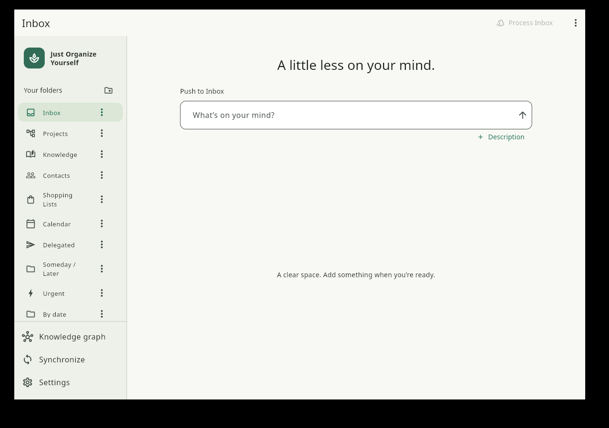

# Just Organize Yourself

### Capture freely. Clarify deliberately. Keep your data portable.

A **Getting Things Done (GTD)** application that stores your workspace on your own devices. Capture a thought, process one Inbox card at a time, organize projects and personal lists, then move your system between devices over the local network or in one Excel workbook.

> **Development build.** The application is implemented for development and review. Automated checks and native build results are recorded in the [QA report](docs/QA_REPORT.md); physical-device, network and platform checks are kept distinct from those results.

[Download for Windows](#download-for-windows) · [Development](#get-started) · [Features](#features) · [Device synchronization](#device-synchronization) · [Data portability](#data-portability) · [Product checklist](docs/PRODUCT_SPEC.md)



*Actual Linux development build running in Xvfb. Android appearance and device behavior require separate validation.*

## Download for Windows

For Windows 10 (2004 or newer) and Windows 11, x64:

- **[Download the installer](https://github.com/v-like-engine/JustOrganizeYourself/releases/download/v0.1.0-windows-preview.1/JOY-Windows-Setup.exe)** — install for your user account, then open the app from the Start menu or desktop shortcut. Administrator rights are not required.
- **[Download the portable ZIP](https://github.com/v-like-engine/JustOrganizeYourself/releases/download/v0.1.0-windows-preview.1/JOY-Windows-Portable.zip)** — extract the whole archive and double-click `JustOrganizeYourself.exe`.

Flutter, Visual Studio, Python, Java and a separate database installation are not required to use these packages. Runtime libraries are bundled. Your tasks stay in your Windows user profile when the application is updated or uninstalled.

This preview is unsigned, so Windows may show an unknown-publisher warning. See the [Windows guide in Russian](docs/WINDOWS.md) and the [release page](https://github.com/v-like-engine/JustOrganizeYourself/releases/tag/v0.1.0-windows-preview.1) for instructions and checksums. Optional semantic embeddings remain a separate component.

## Features

| Area | Experience |
| --- | --- |
| **Inbox first** | A centered capture field, Enter or send-button submission, optional description, persistent entries and a scrollable history. |
| **Folders & subfolders** | Create, rename, describe and reorder your organization. Start with editable GTD categories and Shopping Lists, then add sections for supermarkets, pharmacies or marketplaces. |
| **Projects** | A title, description, free-text plan, completion criterion and ordered actions. Group projects in subfolders; complete mobile project drafts after processing the Inbox. |
| **Focused processing** | One active card, an exact remaining count up to ten and approximate bands above that. Configure eight swipe directions plus tap, or numpad keys 1–9, with menus and direct destinations. |
| **Similar-item hints** | Browse existing tasks while typing without covering the capture field. Selecting a suggestion discards only the unsaved draft. Lightweight word matching works without an embedding model. |
| **Trash** | Configurable retention in days. Expired text and extra data are cleared while minimal deletion history remains for synchronization. |
| **Calendar & delegation** | Record dates, times and an assignee. Export calendar events to `.ics` for Google Calendar. Reverse calendar import is outside the agreed scope. |
| **Knowledge & Contacts** | One graph with two category colors, optional local semantic embeddings and stored layout for later viewing. Ordinary GTD work remains available without a model. |
| **Portable workspace** | SQLite for daily work; one `.xlsx` for data, hierarchy, settings, revisions, deletion markers and supported embedding metadata. |

## Get started

For ordinary Windows use, follow [Download for Windows](#download-for-windows). The SDK and compiler instructions below are for developers building from source.

The interface is written in **Flutter and Dart**. Android is the first mobile target; Linux, Windows and macOS platform projects are included. iOS is not part of this implementation. Native platform validation depends on the host and available devices; see the QA report for what was actually built and run.

Prerequisites:

- Flutter SDK at the version recorded in [.flutter-version](.flutter-version), with its bundled Dart SDK.
- Android SDK and a JDK for Android builds; use `flutter doctor` to check the toolchain and SDK licenses.
- The native Flutter toolchain for your desktop target when building a desktop executable.
- Python 3.11 or newer only when using the separate optional embedding service.

From the repository root:

```sh
make deps
make check
```

To run on an Android device or emulator:

```sh
cd apps/joy
flutter devices
flutter run -d <device-id>
```

To build an ARM64 Android development APK:

```sh
make android
```

Flutter writes it to `apps/joy/build/app/outputs/flutter-apk/app-arm64-v8a-debug.apk`. This is a development artifact, not a store release or production signing setup.

To run the Linux client with its native toolchain installed:

```sh
make run
```

On a suitable Windows or macOS host, run `flutter run -d windows` or `flutter run -d macos` from `apps/joy`. The presence of platform files is not a claim that those builds have been tested on this Linux host.

The client opens `joy.sqlite` in the platform's application-support directory. It does not require a database server, Python process or cloud account for capture, organization, file exchange or peer synchronization.

## Device synchronization

Connect the devices to the same home Wi-Fi or phone hotspot:

1. Open **Synchronize** on the receiving device and choose **Make this device available**.
2. On the other device, enter the receiver's displayed local address and pairing code.
3. Review differences, select versions for conflicts and apply the result.
4. Stop sharing when finished.

The current implementation uses manual address/code pairing. Automatic discovery and QR pairing are not implemented. The temporary receiver uses **HTTP on a trusted local network**; a pairing code does not encrypt traffic. An external synchronization server is not required.

Independent additions from both devices are retained. Revisions and deletion history distinguish an unchanged older copy from a conflicting edit. Visible task numbers are derived from creation time and stable ID; matching numbers do not merge different tasks.

If deleting a folder would leave independent live children without a parent, that choice is blocked with an explanation. Keep the folder or move its children before synchronizing again. The app does not silently delete or relocate those tasks.

The core receiver can also run independently for development:

```sh
cd packages/joy_core
dart run bin/peer.dart joy.sqlite
```

Client isolation on a Wi-Fi network, firewall rules and mobile operating-system restrictions can prevent a connection. Loopback tests do not establish that a physical phone/hotspot scenario has passed.

## Data portability

**Your GTD system → `.xlsx` → another device → your GTD system.**

Folders become workbook sheets; subfolders are represented within their folder's sheet. Projects retain their group, actions and ordering. A metadata sheet keeps the portable schema and settings, so the workbook is sufficient to restore the user system. Optional model weights are installed separately.

- **Add is the default:** new nonconflicting folders and records are combined with existing data; conflicting versions are reviewed.
- **Replace is explicit:** restore the selected state while recording the intentional changes and deletions for later synchronization.
- **Undo either import:** restore the complete previous state until the next data mutation. Navigation and scrolling do not remove this option.
- **Import only Inbox:** accept an ordinary `.xlsx`, including one column without a header. Each nonempty row becomes an item; missing creation dates share one UTC timestamp for that file load.
- **Preserve supported metadata:** descriptions, UTC timestamps, extra attributes, empty sections, project relations, controls and embedding data travel with the workspace.

The workbook schema, long-cell handling and native exchange API are documented in [component contracts](docs/CONTRACTS.md). Legacy binary `.xls` is not supported. An export creates a file and does not mutate the workspace.

## Optional local embeddings

The separately started Python service computes embeddings for Knowledge and Contacts and produces graph positions. The tested model is a quantized multilingual MiniLM model with 384 dimensions and approximately **267 MB** of artifacts, below the agreed 1 GB model-file budget.

Installation and download are explicit. Startup uses verified local weights and does not fetch a model silently. Without weights, the service reports that embeddings are unavailable; your GTD data remains usable.

See [the embedding service instructions](services/embeddings/README.md) for installation, checksum verification, API examples, tests and resource notes. Real model tests are recorded separately from tests using synthetic vectors. Disk size and inference RAM are different measurements.

## Languages

The interface includes English (`en`), Russian (`ru`), French (`fr`), Spanish (`es`), German (`de`) and Serbian (`sr`). English is the default; Serbian currently uses Cyrillic. Language selection is saved locally and travels in portable settings. User text and stable data identifiers are not translated when the interface language changes.

## Components and verification

| Component | Responsibility |
| --- | --- |
| [apps/joy](apps/joy) | Flutter screens, input, localization and review dialogs |
| [packages/joy_core](packages/joy_core) | Shared Dart domain, SQLite, XLSX, calendar export and local peer exchange |
| [services/embeddings](services/embeddings) | Independently started optional Python computation service |

Useful documentation:

- [Product specification and implementation checklist](docs/PRODUCT_SPEC.md) — requirements, acceptance scenarios and open decisions, in Russian.
- [Architecture](docs/ARCHITECTURE.md) and [contracts](docs/CONTRACTS.md) — ownership, schemas and interaction between components.
- [QA report](docs/QA_REPORT.md) — actual test evidence and remaining limitations.
- [Contributing](CONTRIBUTING.md) — development checks and architect/critic review responsibilities.

Tests cover storage, workbook round trips and undo, revision-aware peer exchange, Flutter interactions and the Python API. See the QA report for the current executed counts and results. Native Android, physical-device gestures, household Wi-Fi, Google Calendar and other desktop platforms require their own evidence; they are not inferred from unit tests.
