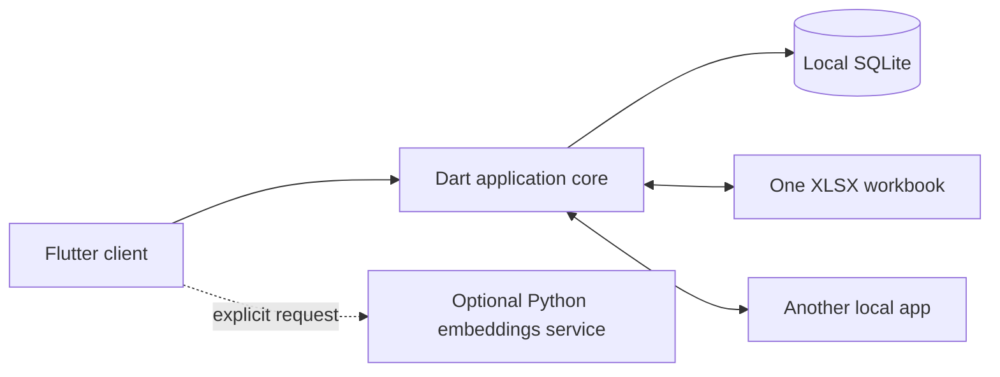

# Architecture

The application runs locally on Android and desktop. Flutter supplies the interface and Dart supplies the shared application logic; these are parts of one stack. Python is used for optional desktop computation. iOS is outside the current delivery target.

## Components

| Location | Responsibility | How it runs |
| --- | --- | --- |
| `apps/joy` | Flutter screens, input, localization, import and conflict dialogs | Android app or desktop executable |
| `packages/joy_core` | Data model, SQLite storage, XLSX exchange, merge rules and local peer transport | Imported into the client; independently tested as a Dart package |
| `services/embeddings` | Optional local embedding computation | Separate Python HTTP process, started explicitly |
| `docs` | Product requirements, component contracts and verification reports | Documentation |

The independently deployable Python component is a service. Local persistence and Inbox interaction remain in process: making each small operation a network service would make an offline phone depend on a server and would add avoidable failure modes. The core separates domain, storage, transfer and sync behind explicit APIs, so their tests and implementation remain independent of Flutter screens.

The phone can capture, organize, import, export and synchronize without Python running. An unavailable embedding service is a visible optional capability, not a reason to stop normal GTD work. The service receives explicit text batches and returns vectors; it does not own the user's SQLite database or assign folders.

## Data flow

There is one local database per device. The workbook contains records, hierarchy, configuration, revisions, deletion markers and supported derived data needed to reconstruct the user system. The optional model weights are installed separately. Credentials for external services are not workbook content.

## Identity, history and task numbers

- Stable record identity is a UUID for user-created records. Starter folders have documented deterministic IDs so two fresh installations share the same destinations.
- Each edit receives a new opaque revision ID and retains prior revision IDs in its ancestry. Creation time and identity are preserved when moving or converting an Inbox entry into a project.
- Deletion uses a tombstone. A stale peer must not recreate an intentionally deleted record through an ordinary union of rows.
- A visible task number is derived from creation time in UTC and then stable ID. It is not a database primary key, a foreign key or a merge identity. Independent records with the same temporary display number remain separate after synchronization.
- Task numbers may change when an earlier record is imported. The interface should refer to stable identity internally and show the current number, rather than promising a permanent external reference.

Full ancestry is retained in this first schema. Compaction requires a later design that preserves conflict detection; history must not be arbitrarily truncated.

## Local synchronization

Peers exchange versioned snapshots over a temporary local receiver. Pairing identifies the intended device. The merge engine combines independent additions, accepts a descendant revision over its unchanged ancestor and reports divergent histories. Conflicting values are selected explicitly in the client; item counts never choose a winning device.

Before committing a result, peers check that the source snapshots have not changed. The transport reports success only after the result has been saved by both sides. If acknowledgment is interrupted after one side commits, the user sees an incomplete exchange and retries; idempotent merge makes that retry safe. This is not a promise of a distributed atomic transaction across disconnected devices.

Home Wi-Fi and a phone hotspot are intended network scenarios. Network isolation and operating-system restrictions are environmental limitations that the UI should explain. No cloud server is necessary for discovery fallback, data exchange or storage.

The current peer transport uses HTTP plus a pairing code on a trusted local network; the code identifies a session and does not encrypt traffic. The receiver is opened only by an explicit sharing action and must be stopped when sharing ends. Do not expose its port to the public Internet. A future encrypted transport would require a separately tested pairing/trust design rather than a claim that a short code provides encryption.

Android declares Internet access and permits the direct local HTTP transport. macOS sandbox entitlements allow client/server network use and user-selected file read/write. These declarations are necessary configuration; they do not substitute for running the app on the target operating system. Native desktop compilation additionally requires that platform's Flutter toolchain. The Linux development toolchain has been prepared in a user-owned prefix and a native debug build compiled. Runtime rendering, Android compilation and other desktop targets have separate evidence in the QA report; a successful host build does not validate every target platform.

## Product boundaries

- Google Calendar integration is **outbound export only**. Importing Google Calendar events into this app requires a new user decision.
- A new feature may be added without another decision only when it is a small supporting detail of an existing requirement, such as identity, task numbering or an import preview. Marketplace purchases and unrelated automation are excluded.
- Code Humanizer is applied as a review for readable, direct code. It does not justify deleting necessary validation, error handling, tests or platform conventions.

## Review responsibilities

The architect reviews ownership, dependencies, schema consistency and scope. The critic independently checks behavior, usability and product requirements, and records concrete tests. Implementers own their bounded component and communicate contract changes before using them. Integration findings are fixed by the responsible owner and rechecked before closure. Completed and unverified requirements remain distinct in the final report.
